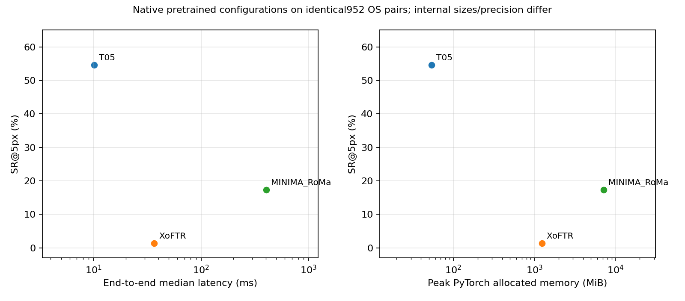

# MINIMA-RoMa、XoFTR与T05：外部参照表

日期：2026-11-27。已完成官方来源/权重核查、两对固定训练样本冒烟、全部952对固定验证和单张RTX5090正式测速；**没有微调或重训，没有修改匹配阈值、没有使用测试集。**

| 方法 | 原生内部输入／精度 | SR@3px | SR@5px | RMSE中位/P90(px) | 求解失败/952 | 完整延迟均值/中位/P95(ms) | 推理峰值allocated(MiB) |
|---|---|---:|---:|---:|---:|---:|---:|
| T05 | 256；BF16 | 34.87% (332/952) | 54.62% (520/952) | 4.365/12.886 | 0 | 10.620/10.138/13.397 | 53.90 |
| XoFTR | 640；FP32 | 0.21% (2/952) | 1.37% (13/952) | 66.877/141.525 | 81 | 36.577/36.741/38.739 | 1237.58 |
| MINIMA_RoMa | 外层640，内部560/864；原FP16/FP32混合 | 5.67% (54/952) | 17.33% (165/952) | 12.728/50.464 | 0 | 409.324/405.005/468.733 | 7183.18 |

**这是同源输入、同硬件、同仿射评价和同计时边界下的原生配置参照。内部尺寸、精度和训练数据不同，不能称同训练域/同内部计算量的严格公平架构对比。** XoFTR原论文主要面向可见光—热红外，这里按用户指定模型作SAR零样本迁移，不把它改称专用SAR训练方法。低分不用于事后调阈值。

## 官方来源与训练域

- **MINIMA-RoMa**：[论文](https://arxiv.org/abs/2412.19412)、[官方MINIMA](https://github.com/LSXI7/MINIMA/tree/796e7721174f9f829b79b3702bf8c2ae9a3d447a)、[固定RoMa子模块](https://github.com/LSXI7/RoMa_minima/tree/0d3fd22dfaf5b7e463a93c3d7f0cbc26df953663)、[官方权重](https://github.com/LSXI7/storage/releases/download/MINIMA/minima_roma.pth)。来源为MegaDepth/MD-syn及RoMa/DINO预训练；本轮原模型对称匹配、原certainty处理、原threshold_balanced采样10000条对应。实际参数415,656,976，其中DINO普通列表内304,368,640，已计入参数和显存。未装xformers，采用官方fallback；没有额外实现加速器。
- **XoFTR**：[论文](https://arxiv.org/abs/2404.09692)、[官方代码](https://github.com/OnderT/XoFTR/tree/e0fbea431b30be9742effbf5577c90aa8eb938f9)、[作者640权重入口](https://drive.google.com/drive/folders/1RAI243OHuyZ4Weo1NiTy280bCE_82s4q)。来源为KAIST可见光/LWIR预训练和MegaDepth微调，原coarse0.3/fine0.1、denser=False；实际参数11,091,722。
- **T05**：冻结主运行epoch18，37,219参数；OS去重7912训练对，当前OS域内基线。检查点SHA为`f9ff3f377394514fce2dd72ef349d7a0a71a10d0b2d73a3bd59ce131e23efe90`。

外部两种权重未声明OS训练，但其完整逐图训练清单不可得，尤其大规模DINO预训练不能逐图排除与OS重叠；**标为“未声明OS、逐图重叠未核实”，不宣称已证明零重叠。** T05是OS训练域内模型，外部是本轮零样本迁移，不据此宣称普遍SOTA。权重、原始第三方源码和逐对应数据不随GitHub发布；许可与更细来源说明见[method_audit.md](method_audit.md)。

## 统一评价协议

全部方法读取原T05的952对源256影像与保存的每图仿射；不重抽扰动。预测坐标按官方接口恢复到原256空间，统一检查有限性、坐标范围和已有有效掩码；这一过滤不读GT。使用原完整仿射RANSAC：阈值3px、min内点6、max迭代5000、confidence.999，种子不变。

预测与拟合之后才读取独立16×16固定探针和附加仿射。SR按RMSE严格小于3/5px、分母固定952；误差分位数仅对求解/探针有定义者计算，并同时报告失败数。XoFTR的81个求解失败没有删除；其余成功拟合也不代表配准达标。5px配准失败分别为T05 432、XoFTR 939、MINIMA 787。

原T05全部952对的矩阵、误差和成败标记均逐对精确复现，统一后过滤移除了0个T05匹配。MINIMA每图原10000条中平均9881.25条通过有效过滤；XoFTR平均155.79条，T05平均272.70条。没有为了公平点数而裁减外部模型原有输出，也没有GT筛正确匹配。

## 正式测速与显存

物理GPU7，RTX5090；batch1、线程4，原24对、24个已验证512父图。它们是输入亮度/对比度分层固定的计时样本，不宣称原始卫星scene独立。独占检查在启动与每对前后执行，同卡没有其他CUDA进程；其他物理卡有无关任务，系统CPU并非绝对空闲。

统一边界：**CPU内存中的原256 uint8影像与mask → 各自预处理/缩放/归一化 → H2D → 原模型推理与原采样 → 官方坐标恢复 → 有效过滤/D2H → 相同完整仿射RANSAC**。不含磁盘I/O、合成影像生成、初始化、GT评价、可视化或逐次写盘；无特征缓存、无hook。MINIMA原代码upsample前的empty_cache与平衡采样成本均计入。

每对每轮3次预热、5次正式重复，三轮轮换方法顺序，每方法360条、合计1080条正式记录。每次GPU只保留一个模型。重复用于测稳定性，不是360个独立场景。三轮中位及标准差：

- T05：9.983, 10.419, 9.927ms；轮间中位标准差0.270ms。
- XoFTR：36.747, 35.811, 37.358ms；轮间中位标准差0.779ms。
- MINIMA_RoMa：403.645, 392.454, 411.703ms；轮间中位标准差9.667ms。

**不能把本表T05的10.14ms与前轮GPU驻留输入的约8ms直接相减判断退化。** 本轮起点移至CPU原图，计入了输入预处理与搬运；所有三组都按这个边界重测。

初始同进程显存验收发现模型卸载后仍有32–33MiB cuBLAS工作区，初始失败和原跨方法峰值均保留。补测为每方法一个全新进程、同24对、逐对3次预热后取峰值。弱引用确认模型和隐藏DINO已释放；测量结束后仅作诊断的库工作区清理将残留allocated降到0，证明不是模型泄漏。表内显存均使用**独立新进程的最大PyTorch allocated**，含模型、激活、采样和本方法库工作区，不含驱动context；不使用受缓存影响的reserved作目标。原三轮延迟不覆盖、不择最快重测。

## 实现核验与结论边界

两种外部权重均严格加载并在相同两对训练来源图上复核官方wrapper：XoFTR坐标/分数逐位一致；MINIMA分数一致，坐标最大差0.0000152588px（官方float64与适配器float32缩放造成），用明确记录的3.1e-5px浮点容差验收。初始更严格检查结果也保留。MINIMA移除了wrapper中冗余GPU→CPU→PIL往返，因此本表是经等价核验的适配器任务时延，不冒充原demo脚本逐行耗时。

122项工程测试通过；独立验收重新对全部2856组保存对应运行仿射估计和探针评价，与记录一致；计时使用的对应数、内点数与准确率阶段一致。源码132文件与权重SHA均复核，无训练和第三方模型源码修改。细节见[acceptance.json](acceptance.json)、[official_io_equivalence.json](official_io_equivalence.json)、[freeze.json](freeze.json)。

本轮显示当前两个公开模型的SAR零样本迁移弱于T05，不能据此定位唯一原因；训练域、OS仅灰度、尺度和原生模型设计都有差异。也不能把合成仿射任务的成绩等同真实scene配准能力。下一阶段应保住现有域内匹配底座，同时证明在线成本下降，不能以外部迁移低分降低精度门槛。

[开发预算v1](开发预算_v1.md) · [机器可读对比表](external_comparison.csv) · [逐样本指标](per_pair_metrics.csv) · [测速原记录](latency_runs.csv) · [复现说明](../../docs/EXTERNAL_REFERENCES_REPRODUCTION_zh.md)

