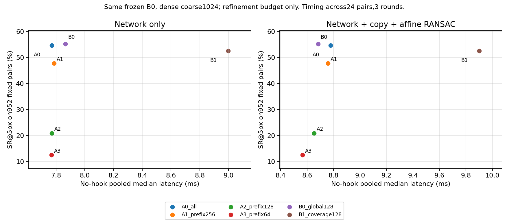

# 固定预算稀疏精化：实现、回归与受控评价

日期：2026-11-27。检查点为冻结T05主运行epoch18，SHA256 `f9ff3f377394514fce2dd72ef349d7a0a71a10d0b2d73a3bd59ce131e23efe90`。模型参数仍为37,219；未训练、未改粗阈值/窗口/RANSAC、未加语义或评分头，未用未精化粗点拟合、未失败回退。

**结论：全量预测路径保持一致；候选数量可正确削减，但当前B0局部算子很小，选择器与调度开销抵消了大部分网络节省。置信度128能保持本轮验证精度，覆盖配额整体更差且更慢。与未修改的T05入口相比，当前稀疏实现没有获得整网加速，不建议现在投入学习型评分器训练。**

## 1. 改造是否保持全量路径一致

冻结文件见[frozen_config.yaml](frozen_config.yaml)、[freeze.json](freeze.json)。yaml内容采用JSON形式（有效YAML1.2子集），包含本轮协议和原匹配器完整配置。原固定952对验证清单、每对仿射、归一化、mask、独立16×16探针和成功/失败规则全部沿用。测试集未使用。

原N分布在正式实验前从T05保存结果审计：min86、P10=202、中位270.5、P90=348.9、max461；不足64者0%，不足128者4/952，不足256者40.44%。因此保留256/128/64预算。冒烟采用已冻结T10训练清单前32对及其原仿射，不用验证结果挑样本。

- all模式与原T05在32对训练来源回归中，候选、精化source/target/score/coarse_target逐位相同；M≥N时global/coverage也直接按原顺序返回。
- all在完整952对验证上的预测矩阵、探针误差和成败标记逐对精确复现原T05，SR@5px仍为520/952=54.6218%。
- 八个新增测试涵盖四模式、None/超预算/零预算/空输入、同分、非方形与边界、水位回收与余数、显式字段对齐、局部valid过滤后索引追踪、批内每影像独立预算，以及实际local输入数等于选择数。全部工程119项测试通过，唯一警告为外部pytest插件弃用接口。
- 32对×6配置共192次冒烟均可运行，实际逐对应local数量等于选择数。零预算单测返回空精化，几何按原协议明确失败，不填伪点。

### 数值差异与初始失败记录

初始预设BF16子集容差1e-4px/热图1e-6在第一对训练样本失败。保留[初始失败](initial_regression_failure.txt)、[初始冻结](freeze_initial.json)、[初始配置](frozen_config_initial.yaml)与[逐算子定位](bf16_operator_diagnosis.json)。窗口源/候选采样完全一致；光学16→32 Linear在BF16下改变矩阵行数后，投影最大差0.03125；随后softmax/偏移传播产生约0.0234px坐标差。FP32同特征子集完全一致，没有发现跨候选归一化、注意力、统计或字段错位。

在继续32对冒烟与952正式验证**之前**，明确修订BF16容差为0.125px、热图0.01，同时增加FP32严格容差1e-4px/1e-6；正式算子、权重和精度没有修改。32对结果：BF16坐标最大差0.03125px、热图最大差0.000872225，FP32两者均0。全部952对保存结果进一步比较，BF16最大坐标差0.04296875px，在修订界限内。**这是已解释且记录时间顺序的数值容差修订，不是声称初始严格测试通过或子集逐位等价。**

详细证据见[regression.json](regression.json)、[regression_checks.csv](regression_checks.csv)、[tests.txt](tests.txt)、[acceptance.json](acceptance.json)。

## 2. 实际减少哪些计算

[implementation_audit.md](implementation_audit.md)给出逐函数调用链、字段形状和坐标含义。选择插在`SparseRefinementB0.refine_packet`的原`self.local(...)`之前：

`原全图backbone/FPN与细特征 → 原1024×1024相关/no-match/互选 → N个粗候选 → 索引选择/统一gather → 原LocalCorrelation(M个) → 原valid过滤 → 原完整仿射RANSAC`。

本轮**固定粗查询K1024，预算M是精化候选数**；不同于T05/T06先限制粗查询K的实验，不可直接混用那些数字。

减少光学1位置/SAR7×7逐对应窗口采样、16→32投影、局部点积/softmax/偏移、返回坐标复制数；RANSAC输入也减少，但其耗时与内点率有关，不一定线性下降。原窗口通过`grid_sample`直接生成，没有整图unfold。全图编码、FPN细特征、描述子、完整相关和粗筛选保持全量。

选择器只返回索引；候选source/target/score/batch_index/valid_mask/original_candidate_idx通过显式schema统一筛选，不按首维大小猜测字段。坐标始终为原输入像素中心(x,y)，保留原半像素、步长换算和align_corners=False。预算按每个image pair分别执行。

原候选是光学粗网格**行序**，prefix偏向上部。global_conf与coverage_conf选择集合后均按原索引升序返回，避免另外引入RANSAC顺序因素。coverage为4×4等额水位分配，格内稳定置信度，同分按原索引；不裁图、不抑制、不加学习配额。当前coverage容量传CPU并循环分配，设备同步及多次小算子成本全部包含正式计时。

## 3. 固定952对精度

所有配置保持原有效过滤。`RMSE中位/P90`仅对几何求解与探针评价有定义者统计；本轮各组952/952均求解，因此无误差缺失。SR使用完整952分母，成功条件仍为RMSE严格小于3/5px。

| 配置 | SR@3px | SR@5px | RMSE中位/P90(px) | 平均选中/有效精化 | 平均内点 | 求解失败 | 配准失败@5px |
|---|---:|---:|---:|---:|---:|---:|---:|
| A0_all | 34.87% | 54.62% | 4.365/12.886 | 272.70/272.70 | 77.49 | 0 | 432 |
| A1_prefix256 | 26.37% | 47.69% | 5.298/13.407 | 240.86/240.86 | 67.21 | 0 | 498 |
| A2_prefix128 | 8.30% | 20.90% | 9.028/20.955 | 127.93/127.93 | 43.16 | 0 | 753 |
| A3_prefix64 | 3.26% | 12.50% | 11.366/26.156 | 64.00/64.00 | 28.64 | 0 | 833 |
| B0_global128 | 36.24% | 55.15% | 4.352/12.823 | 127.93/127.93 | 56.79 | 0 | 427 |
| B1_coverage128 | 32.25% | 52.52% | 4.818/12.922 | 127.93/127.93 | 37.68 | 0 | 452 |

本轮选中与有效精化数量相同是观测结果，不是绕过valid过滤；另有专门单测验证无效窗口被正确丢弃。完整逐样本5712行见[per_pair_metrics.csv](per_pair_metrics.csv)：包含父图、数量、求解状态/原因、全局误差与成败、两端输入覆盖与内点覆盖、近共线状态。

### 配对成败变化

| 参考→候选 | 失败→成功 | 成功→失败 | 净成功数变化 |
|---|---:|---:|---:|
| A0_all→A1_prefix256 | 36 | 102 | -66 |
| A0_all→A2_prefix128 | 28 | 349 | -321 |
| A0_all→A3_prefix64 | 20 | 421 | -401 |
| A0_all→B0_global128 | 84 | 79 | +5 |
| A0_all→B1_coverage128 | 82 | 102 | -20 |
| B0_global128→B1_coverage128 | 77 | 102 | -25 |

全局置信度128相对全量仅净增加5/952个成功，不足以宣称普遍精度提升；同时有84个挽救、79个反转。coverage相对global在77对上挽救、102对上破坏，净少25个成功，不能只展示被挽救案例。

### “局部可用、全局失效”

| 配置 | 粗误差<5px比例 | 名义真对应入7×7窗口比例 | 窗口内精化后均值误差(px) | 输入凸包光学/SAR | 内点凸包光学/SAR |
|---|---:|---:|---:|---:|---:|
| A0_all | 30.18% | 40.51% | 3.283 | 0.810/0.781 | 0.562/0.537 |
| A1_prefix256 | 29.40% | 39.78% | 3.333 | 0.726/0.715 | 0.479/0.461 |
| A2_prefix128 | 30.54% | 40.43% | 3.294 | 0.369/0.508 | 0.213/0.205 |
| A3_prefix64 | 35.79% | 46.00% | 3.162 | 0.159/0.289 | 0.095/0.091 |
| B0_global128 | 44.55% | 56.66% | 3.047 | 0.794/0.765 | 0.527/0.503 |
| B1_coverage128 | 31.58% | 41.57% | 3.264 | 0.787/0.758 | 0.535/0.512 |

这些额外局部量仅事后计算：粗正确率用名义仿射误差，入窗定义逐轴≤6px，未额外按GT可见性筛选，不能与历史T05按GT_visible条件化的诊断混作同一指标。凸包沿用原诊断`size−1`归一化；选择器分格按用户规定的`floor(4*x/W),floor(4*y/H)`，二者不要混为同一坐标转换。

prefix64的粗正确率、入窗率并没有最低，但光学内点凸包降至0.095，全局SR@5仅12.50%。减少点数与行序空间集中共同造成损失；不是仅由“局部精化不准”解释。global128粗正确率更高；coverage128内点数更少，虽然内点凸包略大，整体SR仍更低。光学覆盖不保证SAR覆盖，也不保证匹配正确。

## 4. 无hook正式计时与端到端收益

设备：单张RTX5090（物理GPU7），显式UUID见[timing_environment.json](timing_environment.json)。每对/每轮前后核验无其他CUDA进程；其他物理卡仍有无关任务，不能保证CPU/系统绝对空闲。固定原T05的24对、24个不同已验证512父图，仍不宣称scene独立。

batch1、原BF16 autocast、线程4、确定性/TF32设置不变；3轮、每轮每对每版本5次预热、10次重复，配置及network/complete两种边界随机交错。每次重新完整forward，**没有特征缓存**；无hook、无GT、无逐次写盘或可视化。输入已驻GPU，排除磁盘I/O与CPU→GPU，network至GPU匹配输出；complete加坐标GPU→CPU和原仿射RANSAC。每次边界前后GPU同步。

每配置每边界720次，共8640条正式记录。表内为所有重复的汇总值，不把720次当成720个独立场景；[逐影像逐轮配对差](latency_paired_differences.csv)以24对影像为观察单位。

| 配置 | network均值/中位/P95(ms) | complete均值/中位/P95(ms) | complete三轮中位(ms) | complete峰值分配MiB |
|---|---:|---:|---:|---:|
| A0_all | 7.112/7.771/8.400 | 8.052/8.777/9.528 | 7.010, 6.568, 8.976 | 53.91 |
| A1_prefix256 | 7.115/7.787/8.441 | 8.044/8.759/9.512 | 7.071, 6.609, 8.963 | 53.91 |
| A2_prefix128 | 7.102/7.771/8.429 | 7.937/8.652/9.381 | 6.908, 6.538, 8.856 | 53.91 |
| A3_prefix64 | 7.100/7.770/8.424 | 7.835/8.566/9.210 | 6.919, 6.458, 8.737 | 53.91 |
| B0_global128 | 7.181/7.866/8.464 | 7.937/8.683/9.353 | 6.991, 6.516, 8.844 | 53.91 |
| B1_coverage128 | 8.222/8.997/9.681 | 9.053/9.899/10.602 | 7.877, 7.423, 10.108 | 53.91 |

原全图粗相关与编码峰值仍然存在，因此削减精化未降低本轮峰值分配显存（均53.91MiB）。保留reserved显存原记录，但缓存分配器跨版本保留，不能把reserved当成模型必需显存。

三轮共有明显速度漂移（例如all完整中位7.010→6.568→8.976ms）；报告原数据而不择最快轮。不能只用相互独立的两次计时绝对值比较。按同影像、同轮中位配对后：

| 配置−新增接口all | 平均配对完整延迟差(ms) | 三轮平均配对差(ms) |
|---|---:|---:|
| A0_all | +0.0000 | +0.0000, +0.0000, +0.0000 |
| A1_prefix256 | -0.0046 | -0.0064, -0.0091, +0.0017 |
| A2_prefix128 | -0.1216 | -0.1058, -0.1056, -0.1535 |
| A3_prefix64 | -0.2250 | -0.2299, -0.2137, -0.2314 |
| B0_global128 | -0.1182 | -0.1245, -0.1011, -0.1290 |
| B1_coverage128 | +0.9955 | +0.9500, +0.9141, +1.1224 |

网络部分中位几乎不变，完整微小下降包含RANSAC输入改变产生的时间差，不能全部归为精化加速。coverage当前约多1ms，显式容量CPU同步和16格多次索引是在线成本。

### 与真正原版入口的配对校准

由于新增all接口自身要建立候选packet并统一gather，另用同24对、同3轮×10次的交错校准，比较未修改`UniformB0.predict`、新增all、global128。校准不改主实验、不重新选预算；配置相同，仅同时常驻两个相同权重module，因此该表不用于显存比较。

| 入口 | network中位(ms) | complete中位(ms) |
|---|---:|---:|
| original_T05 | 7.446 | 8.257 |
| A0_all | 7.700 | 8.505 |
| B0_global128 | 7.782 | 8.364 |

配对结果：新增all相对真正原版，network平均多0.256ms、完整多0.264ms；global128相对真正原版，network多0.344ms、完整多0.118ms。**global128比新增all稍快，不等于比原版快。当前实现没有整网加速证据。** 详见[original_reference_paired_summary.csv](original_reference_paired_summary.csv)。

### 独立阶段诊断

阶段诊断在正式无hook测量之后另做，窗口采样临时包裹同步计时并在结束后恢复原函数。初版诊断未显式预热且固定版本顺序，发现首版本启动污染；保留`stage_diagnostics_initial.csv`，仅重做带5次逐版本预热、随机交错的诊断。主无hook计时未覆盖或重选。

下表为诊断中位ms，含同步/仪器开销，**不得相加当作整体速度**。

| 配置 | 编码/FPN | 粗相关及解码 | 选择/gather | 窗口提取 | local余项 | RANSAC |
|---|---:|---:|---:|---:|---:|---:|
| A0_all | 5.544 | 1.110 | 0.128 | 0.657 | 1.076 | 0.826 |
| A1_prefix256 | 5.541 | 1.117 | 0.139 | 0.652 | 1.075 | 0.815 |
| A2_prefix128 | 5.546 | 1.113 | 0.141 | 0.662 | 1.062 | 0.640 |
| A3_prefix64 | 5.542 | 1.115 | 0.139 | 0.657 | 1.060 | 0.566 |
| B0_global128 | 5.552 | 1.112 | 0.232 | 0.660 | 1.066 | 0.589 |
| B1_coverage128 | 5.554 | 1.111 | 1.525 | 0.656 | 1.071 | 0.667 |

可见全图编码和粗相关固定，局部算子受调用/调度开销限制，N减少没有变成明显延迟下降；coverage选择时间明显增加。阶段余项含instrumentation开销，不能据其小差异证明kernel本体获得确定加速。

## 5. 固定案例与决定

案例依据预先规定的两类成败差，按原验证清单顺序取前3例，不按误差最极端挑选：

- 全量成功→prefix128失败：349对符合，展示val/2、val/3、val/4。
- global128失败→coverage128成功：77对符合，展示val/13、val/57、val/69。另有102对反向退化，整体比较仍以完整952对为准。

每例展示全部粗候选、选中/未选中、最终内点、独立探针残差箭头，以及两端凸包/内点凸包/rank/近共线。原像素案例保留在本地交付`failure_cases/`与zzvr私有runs，不上传GitHub。原始逐对应数组亦私有，索引可追溯至全量候选。

本轮支持保留“固定数量精化”作为可用工程开关；当前最合理的无需训练参照是global_conf128。**暂不进入学习评分训练**：首先需要让候选统一gather/排序与小算子开销受控，证明相对未修改原版的在线收益；当前覆盖规则无整体精度或速度优势，不保留为默认。未来若改实现，应另立版本重做回归与计时，不覆盖本轮。

受控合成仿射结果不能消除原光学–SAR配对残差，不代表真实scene配准或OS语义监督。本轮没有把教师伪类别作为任何输入。

## 6. 复现与交付

- [summary.csv](summary.csv)：精度与正式延迟联合表。
- [per_pair_metrics.csv](per_pair_metrics.csv)：952×6全量逐样本结果与两端覆盖。
- [latency_runs.csv](latency_runs.csv)、[latency_paired_differences.csv](latency_paired_differences.csv)：正式原记录与配对差。
- [implementation_audit.md](implementation_audit.md)：首个可省算子、字段与坐标审计。
- [regression_tests.txt](regression_tests.txt)、[tests.txt](tests.txt)、[acceptance.json](acceptance.json)：回归、测试和独立跨文件验收。
- [failure_cases_manifest.json](failure_cases_manifest.json)：固定案例清单，图像本地/服务器私有。
- 工程入口说明：`docs/SPARSE_REFINEMENT_REPRODUCTION_zh.md`。

原网络/几何文件未修改。新增代码、配置、聚合结果与报告同步GitHub；模型、像素图、逐对应数组仅留本地和zzvr。
