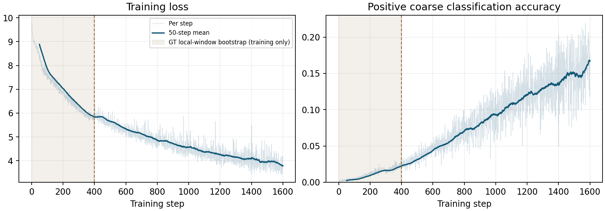

# T02六项交付核对报告

日期：2026-11-25。以下计数、配置、loss和评价均来自已保存实测记录。补图只重新推理，没有重新训练、改变阈值或选择其他checkpoint。

## 1．去重清单实际数量与联合判定

| 分辨率 | 原train记录 | 排除冗余 | 实际保留 | 联合唯一内容数 |
| --- | ---: | ---: | ---: | ---: |
| 256 | 8044 | 132 | 7912 | 7912 |
| 512 | 2011 | 33 | 1978 | 1978 |

联合键是有顺序的 `(光学decoded_sha256, SAR decoded_sha256)`；两个哈希必须同时相同才归入同组。每侧decoded哈希覆盖dtype、shape和解码像素字节，不只比较文件名或编码字节；一侧相同不删除整对。每组按数值样本ID最小确定性保留一条，分辨率内和train内独立处理。
本报告重新读取冻结文件验证SHA、实际行数及双模态联合唯一数。132与33均是保留组代表之后多出的记录数。原始图像和原清单保留，独立派生视图未重划val/test。
全量保留/排除映射：metadata_finalize_v1/train_keep_exclude_mapping_v1.csv；冻结数量和SHA：metadata_finalize_v1/freeze_metadata_v1.json。去重后7912个256子图仍是1978个512父图的四象限，内容关系已验证；卫星原始scene来源映射仍未确认。

## 2．72个控制点分组

| pair_id | 影像对数 | 控制点对应数 | optical宽×高 | SAR宽×高 |
| --- | ---: | ---: | --- | --- |
| osdataset2/scene/optical-sar | 1 | 72 | 35783×35873 | 35507×27298 |

**总计1对影像、72个控制点对应**，不是72对影像。列顺序为`x_optical,y_optical,x_sar,y_sar`，x列/y行。内部按零起点像素中心使用；原始标注起点及中心/角点仍是unverified，未偏移原值。
控制点凸包覆盖光学51.03%、SAR67.57%；4×4网格覆盖11/16、13/16；归一化PCA次/主奇异值比约0.702、0.881，均不近共线。本轮没有用真实scene控制点拟合预测变换、评价模型或调整阈值。

## 3．加载器与评价器新增接口测试

| 类别 | 新增测试 | 结果 |
| --- | --- | --- |
| 加载器 | 扰动范围与组合顺序；重复读取/在线epoch行为；越界和mask无效区域不成正样本 | 3项通过 |
| 独立评价器 | 不导入Torch/model；真值/错误矩阵与失败分母；空/退化对应和外部scene参考点接口 | 3项通过 |
| 基线模型 | 张量尺寸与不接收GT的推理签名；真实CUDA BF16前后向 | 2项通过 |

本轮8项新增全部通过，全仓库52项通过，无失败/跳过。48个真实固定输入再次读取及改变epoch后，图像、A、mask逐位一致；越界正样本数与无效目标正样本数均为0。20组监督连线和mask已单独目视检查。
评价器接口数值：输入真值矩阵误差0.0px；错加平移(5,-3)误差5.830952px；空匹配状态empty_matches，共线状态degenerate_matches。4个接口案例中2次求解失败，5px成功率为1/4，失败保留在分母中。

## 4．小样本训练配置、步数与loss曲线

| 项目 | 实际配置 |
| --- | --- |
| 模型 | B0-Full，37219参数；既定骨干/FPN；1024×1024全量粗相关；简单局部相关；完整affine RANSAC |
| 关闭 | 语义、联合评分、选点/动态预算、局部交叉注意力 |
| 样本 | 去重train固定32对；原val固定16对；本轮影像与矩阵固定 |
| 扰动 | 旋转±10°，等比尺度0.9–1.1，每轴平移±16px，剪切角±5°；中心(127.5,127.5) |
| 矩阵顺序 | T_translation @ T_center @ R @ H @ S @ T_minus_center；H的系数为tan(剪切角) |
| 优化 | AdamW，lr=0.001，weight_decay=0.0001，梯度裁剪5，无学习率搜索 |
| 训练 | seed=20261125，batch4，BF16混合精度，1600步/200个固定epoch |
| 局部训练 | 1–400步GT附近窗口bootstrap；401–1600步预测粗窗口中的有效局部监督 |
| 推理 | 始终预测粗对应→局部精化→RANSAC，没有GT窗口或oracle回退 |
| 保存/恢复 | 400步实际中断并恢复到1600；独立重放401步，batch、loss、梯度范数一致 |
| RANSAC | 3px，最少6内点，最多5000次，confidence0.999；运行前固定 |

前50步平均loss=8.887502，后50步=3.786901，1600步loss/梯度全部有限。下面是实际记录的逐步曲线和50步均值；阴影为仅训练使用GT局部窗口的阶段。

## 5．初始化与训练后的误差、成功率和失败数

所有评价均在固定有效探针上比较预测矩阵与A_forward；探针独立于拟合对应/inlier。初始化和训练后使用相同影像、矩阵、探针与阈值。求解失败不从分母删除；返回矩阵也不等于误差达标。

| 阶段/划分 | 对数 | 求解失败数 | 可求解样本RMSE均值 | RMSE<1px | RMSE<3px | RMSE<5px | 5px配准失败数 |
| --- | ---: | ---: | ---: | ---: | ---: | ---: | ---: |
| 初始化train | 32 | 32 | 未定义（无可用变换） | 0/32（0.000%） | 0/32（0.000%） | 0/32（0.000%） | 32 |
| 训练后train | 32 | 0 | 2.427076px | 2/32（6.250%） | 26/32（81.250%） | 29/32（90.625%） | 3 |
| 初始化val | 16 | 16 | 未定义（无可用变换） | 0/16（0.000%） | 0/16（0.000%） | 0/16（0.000%） | 16 |
| 训练后val | 16 | 0 | 38.836792px | 0/16（0.000%） | 0/16（0.000%） | 1/16（6.250%） | 15 |

训练后在5px内成功样本的条件平均RMSE：train为1.977096px（29个成功样本），val为4.756511px（1个成功样本）。这与所有返回矩阵的样本均值分开报告。初始化没有返回可用矩阵，因此误差不是0，也没有人为填入数值；其成功率为0、失败数保留。
**判断：固定训练样本的匹配闭环成立，但验证泛化仍弱。** 训练后RANSAC求解失败数均0，5px配准失败仍有train 3/32、val 15/16。没有基于val修改阈值或挑选checkpoint，使用预先确定的1600步模型。

## 6．同一批样本的预测粗匹配与最终配准可视化

覆盖固定计划中全部32对train与16对val，按计划顺序保存；未只挑成功案例。每张图使用同一pair_id、同一影像与同一A，四个面板为：

1. 左上：初始化模型预测粗对应；右上：1600步模型预测粗对应。
2. 左下：初始化预测矩阵的配准结果；右下：1600步预测矩阵配准结果。每格左侧光学、右侧光学/已配准SAR棋盘格。
3. 没有预测变换时明确显示失败，不使用identity或GT代替。配准只使用预测affine的逆矩阵将SAR_aug拉回optical坐标域；红边是无效warp支持。
4. 粗线显示最多64条，按源顺序均匀抽样；完整预测在每个案例JSON中。颜色只在推理之后用GT标记粗端点误差：绿<5px、黄5–10px、红≥10px；没有用GT选线、选对应或拟合。

所有48例的重新推理对应和预测矩阵均与原始评价逐项一致。最终局部窗口均来自预测粗对应。

完整图册与48例PNG位于本地 `outputs/T02_B0_Full/六项交付核对/prediction_visuals/index.html`；服务器位于 `runs/t02_b0_full_v1/prediction_visuals/`。原始图像派生的可视化留在本地/服务器；Git保留生成脚本、48例清单和完整预测粗对应/矩阵JSONL。

图中的误差来自独立探针；彩色线与棋盘格用于诊断，不能替代数值评价。合成A监督仍假设原始跨模态配准残差较小，并非人工真实对应完全精确。
