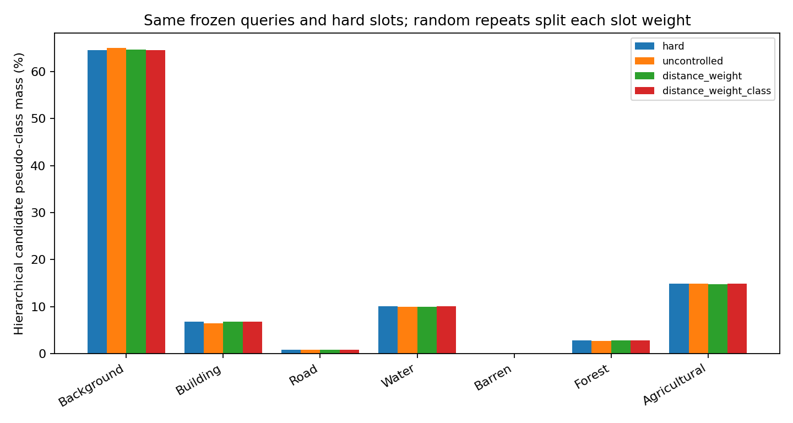
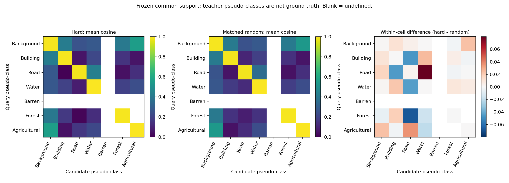

# T10-A共同支持、类别组成与类内残差审计

日期：2026-11-26。仅分析原冻结候选，不训练，不重跑匹配器或教师，不改仿射、候选、相似度、可靠性掩码或阈值。历史T10-A报告与结果保留。

**结论：较大的总体差异主要伴随查询—候选类别组成差异；固定类别组成后的残差很小，正负类别格并存，且存在严重的细分类别重采样支持不足。当前结果不构成启动全量语义损失训练的充分证据。**

## 1. 冻结输入与共同支持

T05第18轮检查点SHA256：`f9ff3f377394514fce2dd72ef349d7a0a71a10d0b2d73a3bd59ce131e23efe90`。

原256对训练影像、128个已验证512父图、每图仿射、top-5高分错误和三个随机对照全部复用。候选数组SHA256：`0f14c498621520596e2ed9f06d630f88e909f61a858a94f6563d4a2a17465130`。具体输入与支持集合哈希见[freeze.json](freeze.json)。

共同支持规则在新分析前写入`configs/t10a_common_support_v1.json`：一条原高分错误记录，必须在未控制、距离＋可靠性匹配、再加候选伪类别匹配这三套原对照中均至少有1个可用随机候选。查询至少有1条这样的记录才保留。**三组比较使用完全相同的查询和高分错误记录，不只固定查询后再各自筛候选。** 无对照时不放宽匹配条件，不补采候选。

| 阶段 | 查询数 | 相对上一适用阶段减少 |
|---|---:|---:|
| 全部256×1024位置 | 262,144 | — |
| 几何与可靠语义掩码同时有效 | 170,185 | 91,959 |
| 至少有一个可靠高分错误 | 161,394 | 8,791 |
| 三套对照共同支持 | 160,163 | 1,231 |

单独的几何有效查询234,740；单独的可靠标签查询189,767，二者不是顺序筛选。共同支持占全部查询61.10%；相对已有可靠高分错误查询再损失0.76%。可靠高分错误记录653,721条，排除16,585条，保留637,136条。

原256对和128父图始终是覆盖分母；最终有233对、126父图具备共同支持。全部排除影像及其阶段计数见[coverage_by_pair.csv](coverage_by_pair.csv)。父图只代表已验证的512裁剪来源，不等于原始卫星scene。

| 查询伪类别 | 原可靠高分错误查询 | 共同支持查询 | 支持筛选排除 | 共同支持查询占比 |
|---|---:|---:|---:|---:|
| Background | 101,345 | 100,610 | 735 | 62.82% |
| Building | 12,128 | 11,971 | 157 | 7.47% |
| Road | 1,465 | 1,445 | 20 | 0.90% |
| Water | 18,109 | 17,950 | 159 | 11.21% |
| Barren | 0 | 0 | 0 | 0.00% |
| Forest | 4,726 | 4,682 | 44 | 2.92% |
| Agricultural | 23,621 | 23,505 | 116 | 14.68% |

Barren在既有教师可靠性规则下无接受查询或候选；不能理解为OS不存在该地物。其余六类也只是外部教师伪类别。掩码前argmax仅用于覆盖诊断，不能当作可信标签。

## 2. 统一统计与权重

先在每个查询内等权平均保留的高分错误，再在影像内等权平均查询、在已验证父图内等权平均可用子块、最后等权平均有支持的父图。每条随机对照记录的总权重与对应高分错误相同，再由其已有1—5个随机候选等分。随机重复数不是独立样本量。

类内表以查询伪类别×候选伪类别定义49格。固定权重为**高分错误与主随机对照两组层级类别质量的1:1混合**，在所有视图均有支持的类别格上只归一化一次，之后对所有比较、所有重采样使用同一套权重。它不是七类均衡权重，仍继承当前数据的类别不均衡。权重只依据组成、支持确定，不根据相似度差值调整。

49格中34格有数据；其余15格包括Barren行/列以及Forest→Agricultural、Agricultural→Forest两格。它们均是原始质量为零的格，未额外丢失任何非零概率质量。权重和各组质量完整列于[fixed_class_weights.csv](fixed_class_weights.csv)。

单格均值用上述共同基础权重在该格内条件化，不对每个格重新改一套影像/父图权重；因此本轮按查询类别的条件均值，与历史报告“各类别子集分别重新等权影像/父图”的结果估计对象不同。总体均值与历史共同队列结果仅有约1e-10的浮点累加差异。

## 3. 候选组成与同类率

下表为层级加权占比，不是把全部随机候选当成独立观测后的简单比例。

| 候选伪类别 | 高分错误 | 未控制随机 | 距离＋可靠性随机 | 再加候选伪类别匹配随机 |
|---|---:|---:|---:|---:|
| Background | 64.521% | 64.928% | 64.653% | 64.521% |
| Building | 6.827% | 6.517% | 6.788% | 6.827% |
| Road | 0.827% | 0.891% | 0.819% | 0.827% |
| Water | 10.062% | 9.952% | 10.050% | 10.062% |
| Barren | 0.000% | 0.000% | 0.000% | 0.000% |
| Forest | 2.840% | 2.753% | 2.840% | 2.840% |
| Agricultural | 14.924% | 14.959% | 14.850% | 14.924% |
| **查询—候选同伪类别率** | 87.436% | 78.521% | 85.555% | 87.436% |

边际候选类别比例很接近，但查询—候选的联合组成不同：高分错误同类率87.436%，主随机对照85.555%。不能仅凭候选总体类别直方图接近，就认为消除了类别组成因素。逐查询类别的候选比例和同类率见[class_composition.csv](class_composition.csv)、[query_class_results.csv](query_class_results.csv)。

## 4. 总体差异、固定权重类内差与分解

以下均为高分错误减去随机对照的软余弦差，数值越大只表示更相似，不代表对应更正确。

| 随机对照 | 总体差 | 父图重采样95%区间 | 固定共同类别权重的类内差 |
|---|---:|---:|---:|
| uncontrolled | 0.07210670 | [0.06138073, 0.08312558] | 0.01230777 |
| distance_weight | 0.01333920 | [0.01035748, 0.01653466] | 0.00164731 |
| distance_weight_class | 0.00101899 | [0.00076327, 0.00127589] | 0.00104308 |

主比较的对称描述性分解：

`0.01333920 = 0.00164731（类内）+ 0.01169189（组成）+ 0（单侧支持）`。

对每格，类内项为`(pH+pR)/2 × (meanH−meanR)`，组成项为`(meanH+meanR)/2 × (pH−pR)`，然后对格求和。主比较使用的固定权重恰为这一混合组成，所以主比较类内项等于固定标准化差。组成项约占总差87.65%，**这是代数分解，不能称为因果解释率或证明移除类别即可消除某比例的匹配错误。**

再加候选伪类别匹配后，联合类别组成相同，总体残差0.00101899。用主比较的同一套固定权重汇总该对照，残差为0.00104308；二者权重不同，数值不要求完全相同。

[完整49格表](joint_class_results.csv)包含每组均值、差值、固定权重、质量、随机个体数、高分错误记录数、唯一查询数、影像数、父图数和重采样有效次数。主比较34格中21格为正、13格为负，未隐藏负值或仅展示显著格。例如Building→Road差−0.046386（高分错误仅2父图），Road→Water差+0.079992（仅1父图）；这类大幅单格差尤其不能概括为稳定规律。

各查询伪类别的主比较结果如下；这里仍未固定候选类别组成，不能把这一表直接称为纯类内语义收益。

| 查询伪类别 | 查询数 | 高分错误均值 | 主随机均值 | 差 | 高分错误同类率 | 主随机同类率 |
|---|---:|---:|---:|---:|---:|---:|
| Background | 100,610 | 0.932905 | 0.923987 | +0.008918 | 91.02% | 89.78% |
| Building | 11,971 | 0.714864 | 0.673886 | +0.040978 | 52.65% | 46.52% |
| Road | 1,445 | 0.568226 | 0.505448 | +0.062778 | 41.74% | 34.62% |
| Water | 17,950 | 0.890385 | 0.867925 | +0.022460 | 85.85% | 82.87% |
| Barren | 0 | 未定义 | 未定义 | 未定义 | 未定义 | 未定义 |
| Forest | 4,682 | 0.848983 | 0.830957 | +0.018026 | 77.31% | 74.52% |
| Agricultural | 23,505 | 0.969319 | 0.961004 | +0.008315 | 95.46% | 94.20% |

## 5. 不确定性、影像汇总与覆盖不足

预先固定种子20261126，执行20,000次配对父图重采样。每次从原128父图中有放回抽取128组，同一组内保留全部子块，全部比较复用相同抽样；无可用查询的子块不伪造零值。对有支持父图求均值。这里的区间只处理已知512父图相关性，不能宣称原始卫星scene独立性。

**完整固定权重类内统计的重采样支持严重不足。** 若某次抽样缺少任一正权重类别格在任一组的数据，则该次完整统计标记未定义，不补零、不改权重、不临时删格。20,000次中仅4,473次（22.365%）可定义，15,527次未定义。

| 随机对照 | 类内差点估计 | 仅在全部格可定义的4,473次上得到的条件95%区间 |
|---|---:|---:|
| uncontrolled | 0.01230777 | [0.01087574, 0.01400671] |
| distance_weight | 0.00164731 | [0.00097980, 0.00245085] |
| distance_weight_class | 0.00104308 | [0.00079328, 0.00134270] |

**这些条件区间不能当作通常无条件父图bootstrap置信区间，也不能因端点为正就强称类内残差稳定显著。** 没有为了补足区间而事后合并类别、删除稀有格或改换度量。

[image_results.csv](image_results.csv)和[parent_results.csv](parent_results.csv)包含全部256对/128父图的原始均值、差、共同查询数和固定类别权重可覆盖质量。主比较有193/233对为正、40对为负；112/126父图为正、14父图为负。这些符号计数只是描述，不代替组内相关性分析。

没有单幅影像或单个父图包含全部34个正权重格，因此逐影像/逐父图完整固定标准化值全部未定义。文件单独提供未归一化的已观测格部分贡献与可覆盖权重，**该部分贡献不是完整类内均值，不能跨图按同一完整估计量解读。** 完整总体点估计可以由全体父图联合数据计算，但重采样时细格缺失是实质限制。

## 6. 饱和程度

使用原保存余弦，不改度量。以下分位数和接近1的比例均使用同一共同支持层级权重；随机组按个体分布统计，每条记录的权重由其可用随机个体等分，而非先平均五个随机分数后再计算分位数。

| 组 | 均值 | P10 | P25 | P50 | P75 | P90 | P95 | ≥0.99 | ≥0.999 |
|---|---:|---:|---:|---:|---:|---:|---:|---:|---:|
| hard | 0.911953 | 0.585860 | 0.974541 | 0.996127 | 0.999687 | 0.999986 | 0.999999 | 63.12% | 34.76% |
| uncontrolled | 0.839846 | 0.275862 | 0.921022 | 0.989600 | 0.998988 | 0.999945 | 0.999993 | 49.49% | 24.91% |
| distance_weight | 0.898614 | 0.495778 | 0.969189 | 0.995444 | 0.999629 | 0.999982 | 0.999998 | 61.02% | 33.19% |
| distance_weight_class | 0.910934 | 0.580251 | 0.973130 | 0.995740 | 0.999644 | 0.999982 | 0.999998 | 62.17% | 33.69% |

余弦分布在1附近明显饱和，大量近似单类的软分布本身就会给出接近1的值。微小正残差不自动等于可利用的配准增益，更不能据此把类别硬编码为可匹配性规则。

## 7. 复现与边界

新增代码：`sglm/t10_composition.py`、`scripts/audit_t10a_composition.py`、`scripts/verify_t10a_composition.py`、`scripts/plot_t10a_composition.py`；新增测试：`tests/test_t10_composition.py`。未改历史分析脚本、模型或训练代码。

- 全套111项测试通过。唯一警告来自已安装pytest插件的弃用接口。
- 接受/排除关系行与共同查询ID以私有`support.npz`保存，并给出文件及规范化整型序列SHA。
- 独立使用原有`paired_parent_summary`复算总体均值和父图区间，与新实现误差小于1e-12。
- 独立检查类权重、49格统计、分解恒等式、类别匹配组的质量一致性。
- 同输入第二次运行，全部数值CSV与统计JSON逐字节一致；见[reproducibility.json](reproducibility.json)。

本轮未新增混淆案例选择；继续使用T10-A原固定16对顺序的案例页。图像、模型权重、原概率和候选数组均不发布到GitHub；配置、代码、聚合数值与报告同步。OS无人工语义GT，所有类别均来自外部光学教师；名义SAR候选语义经逆仿射映回原光学概率图，继承原始配准残差。不存在SAR语义真值或OS语义准确率结论。

本轮仅完成冻结候选的可复现审计；保留微弱的类内残差信号作为研究假设，同时明确类别组成、覆盖不足和饱和的限制，不启动全量训练。
